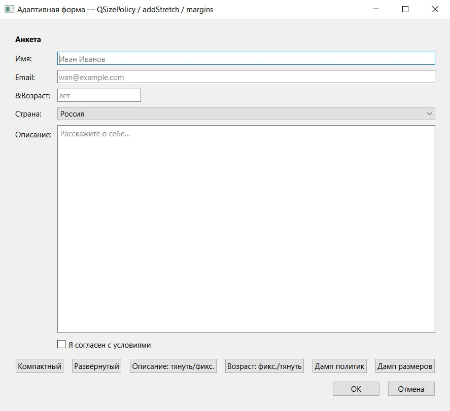
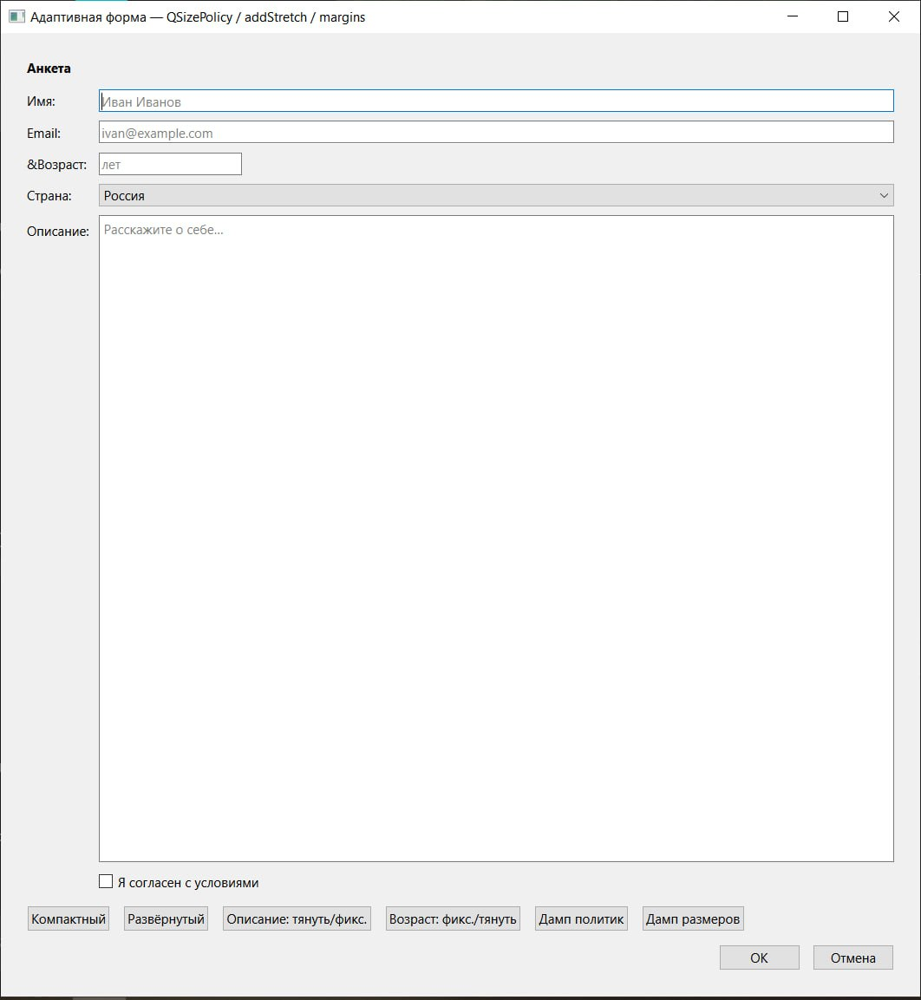
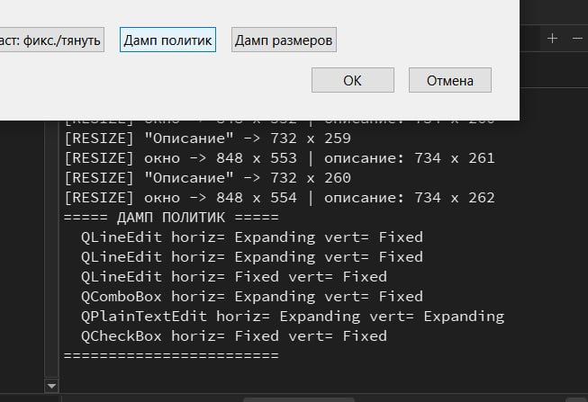
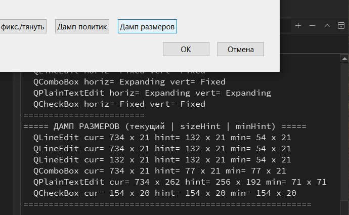

# Лабораторная работа №4. Размерные политики и адаптивные интерфейсы в Qt Widgets

## Описание

**AdaptiveForm** — приложение на C++ и Qt Widgets, демонстрирующее адаптивную анкету на основе `QFormLayout`. Поля изменяют размеры вместе с окном в соответствии с заданными политиками. Пользователь может переключать режимы компоновки и получать диагностические данные через `qDebug()`.

В работе используются:

- `QSizePolicy` (`Fixed`, `Expanding`) — управление растяжением виджетов по горизонтали и вертикали;
- `QFormLayout`, `QVBoxLayout`, `QHBoxLayout` — автоматическая компоновка без файла `.ui`;
- `addStretch()` — распределение свободного пространства;
- `setContentsMargins()`, `setSpacing()` — настройка отступов и промежутков;
- `resizeEvent()` — отслеживание изменения размеров;
- `sizeHint()`, `minimumSizeHint()` и `qDebug()` — диагностика компоновки.

## Структура проекта

```text
Qt-Lab4/
├── .gitignore
├── AdaptiveForm.pro
├── README.md
├── main.cpp
├── adaptivefield.h
├── adaptivefield.cpp
├── formwindow.h
├── formwindow.cpp
└── screenshots/
    ├── main-window.png
    ├── resized-window.png
    ├── policy-dump.png
    └── size-dump.png
```

## Сборка и запуск

Требуется Qt с модулем **Qt Widgets**, компилятор с поддержкой C++17 и `qmake`.

В Qt Creator:

1. Откройте `AdaptiveForm.pro` через **File → Open File or Project**.
2. Выберите установленный комплект сборки (Kit).
3. Выполните **Build → Run qmake**, затем **Build → Rebuild All**.
4. Запустите программу кнопкой **Run**.
5. Откройте **Application Output**, чтобы видеть логи `qDebug()`.

Для проверки адаптивности растягивайте окно по ширине и высоте. В проекте включён `CONFIG += console` для просмотра диагностического вывода в Windows.

## Поля анкеты

| Поле | Поведение |
| --- | --- |
| Имя и Email | Растягиваются по ширине, высота фиксирована |
| Возраст | По умолчанию фиксированная ширина, можно переключить в `Expanding` |
| Страна | Растягивается по ширине |
| Описание | Растягивается по двум осям; высоту можно зафиксировать |
| Согласие | Не растягивается |

## Управление

| Элемент | Действие |
| --- | --- |
| Компактный | Установить `margins = 8`, `spacing = 4` |
| Развёрнутый | Установить `margins = 24`, `spacing = 12` |
| Описание: тянуть/фикс. | Переключить вертикальную политику между `Expanding` и `Fixed` |
| Возраст: фикс./тянуть | Переключить горизонтальную политику между `Fixed` и `Expanding` |
| Дамп политик | Вывести горизонтальные и вертикальные `QSizePolicy` полей |
| Дамп размеров | Вывести текущий размер, `sizeHint()` и `minimumSizeHint()` |
| ОК | Вывести заполненные данные в лог и закрыть окно |
| Отмена | Закрыть окно |

## Пример работы

Главное окно анкеты:



Окно, увеличенное по ширине и высоте: поле «Описание» занимает свободное пространство.



Вывод текущих политик элементов после нажатия «Дамп политик»:



Вывод фактических размеров, `sizeHint()` и `minimumSizeHint()` после нажатия «Дамп размеров»:



Пример формата сообщений в консоли (`qDebug()`, числовые размеры зависят от системы и окна):

```text
[RESIZE] "Описание" -> 400 x 260
[MARGIN] компактный: margins=8, spacing=4
[TOGGLE] описание вертикально -> Fixed
===== ДАМП ПОЛИТИК =====
  QLineEdit horiz= Expanding vert= Fixed
===== ДАМП РАЗМЕРОВ (текущий | sizeHint | minHint) =====
  QLineEdit cur= 400 x 24 hint= 176 x 24 min= 24 x 24
```

Этот фрагмент иллюстрирует **формат** лога, а не является записью конкретного запуска. Для сравнения размеров до и после растяжения следует использовать фактический вывод приложения.

## Проверка адаптивности

1. При увеличении высоты окна поле «Описание» растягивается по вертикали.
2. При увеличении ширины поля «Имя», «Email», «Страна» и «Описание» расширяются; поле «Возраст» изначально остаётся коротким.
3. В компактном и развёрнутом режимах меняются отступы и промежутки.
4. В режиме `Fixed` поле «Описание» больше не заполняет свободную высоту окна.
5. После переключения «Возраст» в `Expanding` поле может расширяться по горизонтали.
6. Кнопки дампов выводят политики и размеры для диагностики.

## Контрольные вопросы

### 1. Как заставить поле ввода тянуться по ширине вместе с окном?

Установить для него горизонтальную политику `QSizePolicy::Expanding` и разместить внутри layout, например `QFormLayout`.

### 2. Как прижать кнопки «ОК / Отмена» к правому краю, чтобы они не растянулись на всю ширину?

Создать `QHBoxLayout`, первым добавить `addStretch()`, затем кнопки. Пружина занимает свободное место слева.

### 3. Как задать между двумя группами виджетов зазор, который растёт вместе с окном, а как — фиксированный?

Для растягиваемого зазора использовать `addStretch()`, для фиксированного — `addSpacing(px)`.

### 4. Как задать виджету размер, ниже которого layout его не сожмёт?

Вызвать `setMinimumSize()` или `setMinimumWidth()` / `setMinimumHeight()`. Layout также учитывает `minimumSizeHint()`.

### 5. Как уменьшить отступы от краёв окна до содержимого?

Уменьшить параметры основного layout через `setContentsMargins(left, top, right, bottom)`.

### 6. Как убрать двойные отступы, когда форма вложена в основной layout?

У вложенного `QFormLayout` задать `setContentsMargins(0, 0, 0, 0)`, а общие отступы задавать в основном layout.

### 7. Как построить двухколоночную форму «подпись: поле»?

Использовать `QFormLayout` и добавлять строки методом `addRow(label, field)`.

### 8. Как в такой форме оставить одно поле коротким, а остальные — тянущимися?

Для короткого поля установить `QSizePolicy::Fixed`, поместить его в `QHBoxLayout` с `addStretch()` и добавить эту строку в `QFormLayout`. Остальным полям установить `Expanding`.

### 9. Как поменять политику виджета «на лету» и чтобы эффект наступил сразу?

Прочитать `sizePolicy()`, изменить нужную ось через `setHorizontalPolicy()` или `setVerticalPolicy()`, вызвать `setSizePolicy()` и `updateGeometry()`.

### 10. Как заставить многострочное поле расти по высоте вместе с окном?

Для `QPlainTextEdit` установить вертикальную политику `QSizePolicy::Expanding` и разместить его в layout с доступным свободным пространством.

### 11. Как в логе убедиться, что конкретное поле реально меняется при растяжении окна?

Переопределить `resizeEvent()` и вывести новый размер (`event->size()`) через `qDebug()`. Сравнить сообщения `[RESIZE]` до и после изменения окна.

### 12. Как вывести текущие политики и размеры всех полей, чтобы отладить вёрстку?

Пройти по списку виджетов и через `qDebug()` вывести `sizePolicy().horizontalPolicy()`, `sizePolicy().verticalPolicy()`, `width()`, `height()`, `sizeHint()` и `minimumSizeHint()`.

## Репозиторий

https://github.com/artem43r/Qt-Lab4

В репозитории хранятся только исходники, документация и скриншоты. Файлы сборки исключены через `.gitignore`.
